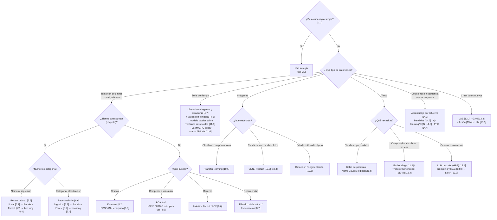

# 🧭 ¿Qué modelo uso?

Un mapa para elegir **por dónde empezar** según el tipo de dato y el tipo de problema. Junta los diagramas de la [Lección 5.7](../nivel-2-aprendiz/m05-modelos-clasicos/5.7-comparativa-que-modelo-uso.ipynb) (modelos clásicos) y la receta tabular de la [Lección 6.6](../nivel-3-practicante/m06-ensambles/6.6-por-que-los-arboles-dominan-lo-tabular.ipynb), y los extiende al resto del curso.

> ⚠️ Es un **punto de partida, nunca una sentencia**. La última palabra la tiene la validación cruzada con la métrica del negocio ([4.6](../nivel-2-aprendiz/m04-evaluacion/4.6-validacion-cruzada.ipynb), [4.8](../nivel-2-aprendiz/m04-evaluacion/4.8-metrica-segun-costo.ipynb)), siempre contra una **línea base** ([4.7](../nivel-2-aprendiz/m04-evaluacion/4.7-lineas-base.ipynb)). Y recuerda que no hay almuerzo gratis ([1.6](../nivel-1-cero/m01-que-es-ml/1.6-no-hay-almuerzo-gratis.ipynb)): ningún modelo gana siempre.

Material de apoyo: [Glosario](glosario.md) · [Chuleta de hiperparámetros](chuleta-hiperparametros.md) · [Diagnóstico del entrenamiento](diagnostico-entrenamiento.md) · [Recursos](recursos.md) · [Volver al README](../README.md)

## Índice

1. [Diagrama general (Mermaid)](#1-diagrama-general-mermaid)
2. [Diagrama general (ASCII)](#2-diagrama-general-ascii)
3. [Zoom: datos tabulares supervisados](#3-zoom-datos-tabulares-supervisados)
4. [Cuándo NO usar ensambles de árboles](#4-cuándo-no-usar-ensambles-de-árboles)
5. [Los modelos en una línea](#5-los-modelos-en-una-línea)
6. [Dónde se explica cada destino](#6-dónde-se-explica-cada-destino)

---

## 1. Diagrama general (Mermaid)

Los números entre corchetes son lecciones; los enlaces están en la [tabla final](#6-dónde-se-explica-cada-destino).



---

## 2. Diagrama general (ASCII)

```
¿Basta una regla simple? (1.1) ── Sí ──► Usa la regla. No necesitas ML.
 │
 No
 │
 ▼
¿Qué tipo de dato tienes?
 │
 ├── TABLA (clientes, ventas, créditos…)
 │     ├── ¿Tienes etiqueta? ── Sí ──► SUPERVISADO (ver zoom, sección 3)
 │     │                              ├── Número (regresión) ──► lineal (5.1) → Random Forest (6.2) → boosting (6.4)
 │     │                              └── Categoría (clasif.) ──► logística (5.2) → Random Forest (6.2) → boosting (6.4)
 │     └── No ──► NO SUPERVISADO
 │                ├── Grupos ───────────────► K-means (8.2) · DBSCAN/HDBSCAN o jerárquico (8.3)
 │                ├── Comprimir / visualizar ► PCA (8.4) · t-SNE/UMAP solo para dibujar (8.5)
 │                ├── Rarezas ──────────────► Isolation Forest / LOF (8.6)
 │                └── Recomendar ───────────► filtrado colaborativo / factorización (8.7)
 │
 ├── SERIE DE TIEMPO ──► líneas base ingenua y estacional (4.7) + TimeSeriesSplit (4.6)
 │                       → modelo tabular sobre ventanas de retardos (11.1) · predecir el CAMBIO si hay tendencia (6.6)
 │                       → LSTM/GRU solo con mucha historia (11.4)
 │
 ├── IMÁGENES
 │     ├── Clasificar con pocas fotos ──► transfer learning (10.5)
 │     ├── Clasificar con muchas fotos ─► CNN (10.3) / ResNet (10.4)
 │     └── ¿Dónde está cada objeto? ────► detección / segmentación; ViT con muchos datos (10.6)
 │
 ├── TEXTO
 │     ├── Clasificar con pocos datos ──► bolsa de palabras + Naive Bayes / logística (5.6, 11.1)
 │     ├── Comprender (clasificar, buscar) ► embeddings (11.2) · encoder tipo BERT (12.4)
 │     └── Generar / conversar ─────────► decoder tipo GPT (12.4) → prompting y RAG (13.8) → LoRA (13.7)
 │
 ├── CREAR DATOS NUEVOS ──► VAE (13.2) · GAN (13.3) · difusión (13.4) · LLM (13.5)
 │
 └── DECISIONES EN SECUENCIA CON RECOMPENSA ──► refuerzo (14.1)
                                                 bandidos (14.2) · Q-learning/DQN (14.3) · PPO (14.4)
                                                 ¡compara antes con una regla simple! (14.5)
```

---

## 3. Zoom: datos tabulares supervisados

Esta es la parte donde más decisiones se toman. Combina el diagrama de la [Lección 5.7](../nivel-2-aprendiz/m05-modelos-clasicos/5.7-comparativa-que-modelo-uso.ipynb) con la receta de la [Lección 6.6](../nivel-3-practicante/m06-ensambles/6.6-por-que-los-arboles-dominan-lo-tabular.ipynb).

### 3.1 La receta (de menos a más) — [6.6](../nivel-3-practicante/m06-ensambles/6.6-por-que-los-arboles-dominan-lo-tabular.ipynb)

```
1. Línea base tonta        → "predecir el promedio / la clase mayoritaria" (4.7)
2. Línea base simple       → regresión lineal/logística (5.1, 5.2): ¿ya basta? ¿se puede explicar?
3. Random Forest de fábrica → casi nunca sale mal; te dice cuánto hay por ganar (6.2)
4. Boosting moderno        → HistGB / LightGBM / XGBoost / CatBoost con parada temprana (6.4)
5. Ajuste razonable        → learning_rate, tamaño de árbol, mínimo por hoja (Módulo 7)
6. Mejores datos           → nuevas variables (2.4): suelen ganar más que el paso 5
7. ¿Ensamble de ensambles? → stacking solo si la mejora vale la complejidad (6.5)
```

### 3.2 Cuando tienes una restricción concreta — [5.7](../nivel-2-aprendiz/m05-modelos-clasicos/5.7-comparativa-que-modelo-uso.ipynb)

```
¿Qué quieres predecir?
 │
 ├── Un NÚMERO (regresión)
 │     ├── ¿Relación casi lineal o necesitas explicar el efecto de cada variable? ──► Regresión lineal (5.1)
 │     ├── ¿Vas a predecir fuera del rango visto? ──► Regresión lineal (árboles y KNN no extrapolan)
 │     └── ¿Relación no lineal compleja? ──► Árbol (5.4) → mejor aún, ensambles (M6)
 │
 └── Una CATEGORÍA (clasificación)
       ├── ¿Es TEXTO o tienes MUY POCOS datos? ──► Naive Bayes (5.6) como línea base
       ├── ¿Debes EXPLICAR cada decisión con reglas? ──► Árbol poco profundo (5.4)
       ├── ¿Necesitas PROBABILIDADES fiables (umbral por costos)? ──► Regresión logística (5.2)
       ├── ¿Pocas características numéricas y datos moderados? ──► KNN escalado (5.3)
       ├── ¿Frontera compleja, hasta decenas de miles de filas, buscas precisión? ──► SVM RBF (5.5)
       └── ¿No sabes? ──► Empieza por la LOGÍSTICA y compara con un árbol, un Random Forest y un boosting
```

### 3.3 Preguntas que cambian la elección

| Si… | Entonces… | Lección |
|---|---|---|
| La clase importante es rara | Mide con recall/precisión o costo, usa `class_weight` o mueve el umbral | [2.7](../nivel-1-cero/m02-datos/2.7-datos-desbalanceados.ipynb), [4.8](../nivel-2-aprendiz/m04-evaluacion/4.8-metrica-segun-costo.ipynb) |
| Hay que explicar cada decisión a un cliente o regulador | Modelo lineal o árbol poco profundo; si usas boosting, explicaciones (SHAP, contrafactuales) | [7.6](../nivel-3-practicante/m07-regularizacion-y-ajuste/7.6-interpretabilidad.ipynb), [15.6](../nivel-5-heroe/m15-produccion-y-etica/15.6-explicabilidad-y-regulacion.ipynb) |
| Hay muchas columnas inútiles o más columnas que filas | Regularización, selección dentro del pipeline, árboles | [2.8](../nivel-1-cero/m02-datos/2.8-maldicion-de-la-dimensionalidad.ipynb), [7.1](../nivel-3-practicante/m07-regularizacion-y-ajuste/7.1-regularizacion.ipynb) |
| Hay categorías con muchísimos valores | CatBoost o `TargetEncoder` (sin fugas) | [2.3](../nivel-1-cero/m02-datos/2.3-preparacion-escalado-y-codificacion.ipynb), [6.4](../nivel-3-practicante/m06-ensambles/6.4-xgboost-lightgbm-y-catboost.ipynb) |
| Las predicciones deben ser rapidísimas | Evita KNN y SVM con muchos datos; lineal o árboles | [5.7](../nivel-2-aprendiz/m05-modelos-clasicos/5.7-comparativa-que-modelo-uso.ipynb) |
| Hay varias filas por persona o datos con fecha | Valida con `GroupKFold` o `TimeSeriesSplit` antes de comparar modelos | [4.6](../nivel-2-aprendiz/m04-evaluacion/4.6-validacion-cruzada.ipynb), [7.5](../nivel-3-practicante/m07-regularizacion-y-ajuste/7.5-pipelines-sin-fugas.ipynb) |

---

## 4. Cuándo NO usar ensambles de árboles

De la [Lección 6.6](../nivel-3-practicante/m06-ensambles/6.6-por-que-los-arboles-dominan-lo-tabular.ipynb): en tablas suelen ganar, pero no siempre.

| Situación | Por qué los árboles sufren | Alternativa |
|---|---|---|
| Hay que **extrapolar** (tendencias, valores fuera del rango visto) | Predicen "lo último que vieron" | Modelo lineal, o árboles sobre el **cambio** |
| Relación **suave y casi lineal**, con **pocos datos** | Aproximan una recta con escalones | Regresión lineal/logística regularizada |
| **Imágenes, audio, texto** crudos | Un píxel o una palabra suelta no significa nada por sí solo | Redes neuronales ([M9](../nivel-4-avanzado/m09-redes-neuronales/)–[M13](../nivel-5-heroe/m13-generativos-llms/)) |
| Necesitas una **fórmula** o reglas legibles | Cientos de árboles no se leen | Árbol simple, modelo lineal o explicaciones ([7.6](../nivel-3-practicante/m07-regularizacion-y-ajuste/7.6-interpretabilidad.ipynb)) |
| **Muy pocos datos** (decenas de filas) | Poca información para cortar bien | Modelos simples + conocimiento del dominio |

---

## 5. Los modelos en una línea

| Modelo | En una frase | Su mejor momento | Su talón de Aquiles | Lección |
|---|---|---|---|---|
| Regresión lineal | Punto de partida + suma ponderada | Explicar efectos y extrapolar tendencias | Relaciones curvas, atípicos | [5.1](../nivel-2-aprendiz/m05-modelos-clasicos/5.1-regresion-lineal.ipynb) |
| Regresión logística | La recta convertida en probabilidad | Línea base de clasificación; umbral por costos | Fronteras no lineales | [5.2](../nivel-2-aprendiz/m05-modelos-clasicos/5.2-regresion-logistica.ipynb) |
| KNN | "Dime con quién andas" | Pocas características; explicar con casos parecidos | Sin escalar; muchas dimensiones; datos enormes | [5.3](../nivel-2-aprendiz/m05-modelos-clasicos/5.3-k-vecinos-mas-cercanos.ipynb) |
| Árbol de decisión | El juego de las 20 preguntas | Reglas explicables, sin preparar datos | Sobreajuste e inestabilidad | [5.4](../nivel-2-aprendiz/m05-modelos-clasicos/5.4-arboles-de-decision.ipynb) |
| SVM | La calle más ancha | Datos medianos con fronteras complejas | Lenta con muchos datos; sin probabilidades | [5.5](../nivel-2-aprendiz/m05-modelos-clasicos/5.5-maquinas-de-vectores-de-soporte.ipynb) |
| Naive Bayes | El detective que suma pistas | Texto y pocos datos; rapidez | Probabilidades exageradas | [5.6](../nivel-2-aprendiz/m05-modelos-clasicos/5.6-naive-bayes.ipynb) |
| Random Forest | Un bosque de árboles distintos que vota | Primera opción robusta en tablas | No extrapola; modelos pesados | [6.2](../nivel-3-practicante/m06-ensambles/6.2-bagging-y-random-forest.ipynb) |
| Gradient boosting | Árboles que corrigen los errores de los anteriores | Precisión de punta en tablas | Hay que ajustarlo y usar parada temprana | [6.3](../nivel-3-practicante/m06-ensambles/6.3-boosting-adaboost-y-gradient-boosting.ipynb), [6.4](../nivel-3-practicante/m06-ensambles/6.4-xgboost-lightgbm-y-catboost.ipynb) |
| Stacking / voting | Un comité de modelos distintos | Exprimir las últimas décimas | Complejidad y riesgo de fuga | [6.5](../nivel-3-practicante/m06-ensambles/6.5-stacking-y-voting.ipynb) |
| K-means | Repartir carritos de helado en la playa | Grupos redondos y parecidos | Atípicos, formas raras, sin escalar | [8.2](../nivel-3-practicante/m08-no-supervisado/8.2-k-means.ipynb) |
| DBSCAN | Multitudes densas | Formas arbitrarias y ruido | Densidades distintas; sin `predict` | [8.3](../nivel-3-practicante/m08-no-supervisado/8.3-jerarquico-y-dbscan.ipynb) |
| PCA | La mejor "foto" de los datos | Comprimir y visualizar | Estructura no lineal; componentes difíciles de explicar | [8.4](../nivel-3-practicante/m08-no-supervisado/8.4-pca.ipynb) |
| Isolation Forest | Lo raro se aísla con pocos cortes | Anomalías globales en tablas | Anomalías locales o en grupo | [8.6](../nivel-3-practicante/m08-no-supervisado/8.6-deteccion-de-anomalias.ipynb) |
| Red densa (MLP) | Capas de neuronas que doblan el espacio | Problemas no lineales con muchos datos | En tablas suele perder contra el boosting | [9.2](../nivel-4-avanzado/m09-redes-neuronales/9.2-capas-y-profundidad.ipynb), [6.6](../nivel-3-practicante/m06-ensambles/6.6-por-que-los-arboles-dominan-lo-tabular.ipynb) |
| CNN | Filtros que detectan patrones donde estén | Imágenes | Necesita muchos datos (o transfer learning) | [10.3](../nivel-4-avanzado/m10-vision/10.3-pooling-y-jerarquia.ipynb) |
| LSTM / GRU | Memoria con puertas | Secuencias moderadas | Lentas; memoria limitada frente a la atención | [11.4](../nivel-4-avanzado/m11-secuencias/11.4-lstm-y-gru.ipynb) |
| Transformer | Cada token atiende a todos los demás | Texto y casi todo con muchos datos | Costo n² con el contexto; hambre de datos | [12.3](../nivel-4-avanzado/m12-transformers/12.3-multicabeza-posicion-bloque.ipynb) |
| LLM | Predecir el siguiente token a escala gigante | Lenguaje, tareas abiertas | Alucinaciones; costo | [13.5](../nivel-5-heroe/m13-generativos-llms/13.5-como-se-entrena-un-llm.ipynb), [13.9](../nivel-5-heroe/m13-generativos-llms/13.9-alucinaciones-y-limites.ipynb) |

---

## 6. Dónde se explica cada destino

| Destino del diagrama | Lección |
|---|---|
| ¿Necesitas ML o basta una regla? | [1.1](../nivel-1-cero/m01-que-es-ml/1.1-programacion-tradicional-vs-aprendizaje.ipynb) |
| Tipos de aprendizaje y de problema | [1.3](../nivel-1-cero/m01-que-es-ml/1.3-tipos-de-aprendizaje.ipynb), [1.4](../nivel-1-cero/m01-que-es-ml/1.4-tipos-de-problema.ipynb) |
| Líneas base | [4.7](../nivel-2-aprendiz/m04-evaluacion/4.7-lineas-base.ipynb) |
| Validación cruzada (k-fold, estratificada, temporal) | [4.6](../nivel-2-aprendiz/m04-evaluacion/4.6-validacion-cruzada.ipynb) |
| Regresión lineal · logística | [5.1](../nivel-2-aprendiz/m05-modelos-clasicos/5.1-regresion-lineal.ipynb) · [5.2](../nivel-2-aprendiz/m05-modelos-clasicos/5.2-regresion-logistica.ipynb) |
| KNN · árbol · SVM · Naive Bayes | [5.3](../nivel-2-aprendiz/m05-modelos-clasicos/5.3-k-vecinos-mas-cercanos.ipynb) · [5.4](../nivel-2-aprendiz/m05-modelos-clasicos/5.4-arboles-de-decision.ipynb) · [5.5](../nivel-2-aprendiz/m05-modelos-clasicos/5.5-maquinas-de-vectores-de-soporte.ipynb) · [5.6](../nivel-2-aprendiz/m05-modelos-clasicos/5.6-naive-bayes.ipynb) |
| Comparativa de modelos clásicos | [5.7](../nivel-2-aprendiz/m05-modelos-clasicos/5.7-comparativa-que-modelo-uso.ipynb) |
| Random Forest · boosting · XGBoost/LightGBM/CatBoost · stacking | [6.2](../nivel-3-practicante/m06-ensambles/6.2-bagging-y-random-forest.ipynb) · [6.3](../nivel-3-practicante/m06-ensambles/6.3-boosting-adaboost-y-gradient-boosting.ipynb) · [6.4](../nivel-3-practicante/m06-ensambles/6.4-xgboost-lightgbm-y-catboost.ipynb) · [6.5](../nivel-3-practicante/m06-ensambles/6.5-stacking-y-voting.ipynb) |
| Por qué los árboles dominan lo tabular | [6.6](../nivel-3-practicante/m06-ensambles/6.6-por-que-los-arboles-dominan-lo-tabular.ipynb) |
| K-means · jerárquico y DBSCAN · PCA · t-SNE y UMAP | [8.2](../nivel-3-practicante/m08-no-supervisado/8.2-k-means.ipynb) · [8.3](../nivel-3-practicante/m08-no-supervisado/8.3-jerarquico-y-dbscan.ipynb) · [8.4](../nivel-3-practicante/m08-no-supervisado/8.4-pca.ipynb) · [8.5](../nivel-3-practicante/m08-no-supervisado/8.5-tsne-y-umap.ipynb) |
| Anomalías · recomendación | [8.6](../nivel-3-practicante/m08-no-supervisado/8.6-deteccion-de-anomalias.ipynb) · [8.7](../nivel-3-practicante/m08-no-supervisado/8.7-sistemas-de-recomendacion.ipynb) |
| Series de tiempo · LSTM/GRU | [11.1](../nivel-4-avanzado/m11-secuencias/11.1-datos-con-orden.ipynb) · [11.4](../nivel-4-avanzado/m11-secuencias/11.4-lstm-y-gru.ipynb) |
| CNN · arquitecturas · transfer learning · detección/segmentación/ViT | [10.3](../nivel-4-avanzado/m10-vision/10.3-pooling-y-jerarquia.ipynb) · [10.4](../nivel-4-avanzado/m10-vision/10.4-arquitecturas-iconicas.ipynb) · [10.5](../nivel-4-avanzado/m10-vision/10.5-transfer-learning.ipynb) · [10.6](../nivel-4-avanzado/m10-vision/10.6-deteccion-segmentacion-y-vit.ipynb) |
| Embeddings · encoder vs. decoder | [11.2](../nivel-4-avanzado/m11-secuencias/11.2-tokens-y-embeddings.ipynb) · [12.4](../nivel-4-avanzado/m12-transformers/12.4-encoder-decoder.ipynb) |
| VAE · GAN · difusión · cómo se entrena un LLM | [13.2](../nivel-5-heroe/m13-generativos-llms/13.2-autoencoders-y-vaes.ipynb) · [13.3](../nivel-5-heroe/m13-generativos-llms/13.3-gans.ipynb) · [13.4](../nivel-5-heroe/m13-generativos-llms/13.4-modelos-de-difusion.ipynb) · [13.5](../nivel-5-heroe/m13-generativos-llms/13.5-como-se-entrena-un-llm.ipynb) |
| LoRA · prompting, RAG y agentes | [13.7](../nivel-5-heroe/m13-generativos-llms/13.7-lora-y-cuantizacion.ipynb) · [13.8](../nivel-5-heroe/m13-generativos-llms/13.8-prompting-rag-y-agentes.ipynb) |
| Refuerzo: problema, bandidos, Q-learning/DQN, PPO, casos reales | [14.1](../nivel-5-heroe/m14-refuerzo/14.1-agente-entorno-accion-recompensa.ipynb) · [14.2](../nivel-5-heroe/m14-refuerzo/14.2-exploracion-vs-explotacion.ipynb) · [14.3](../nivel-5-heroe/m14-refuerzo/14.3-q-learning-y-dqn.ipynb) · [14.4](../nivel-5-heroe/m14-refuerzo/14.4-gradientes-de-politica-y-ppo.ipynb) · [14.5](../nivel-5-heroe/m14-refuerzo/14.5-casos-famosos-alphago-robotica-rlhf.ipynb) |
